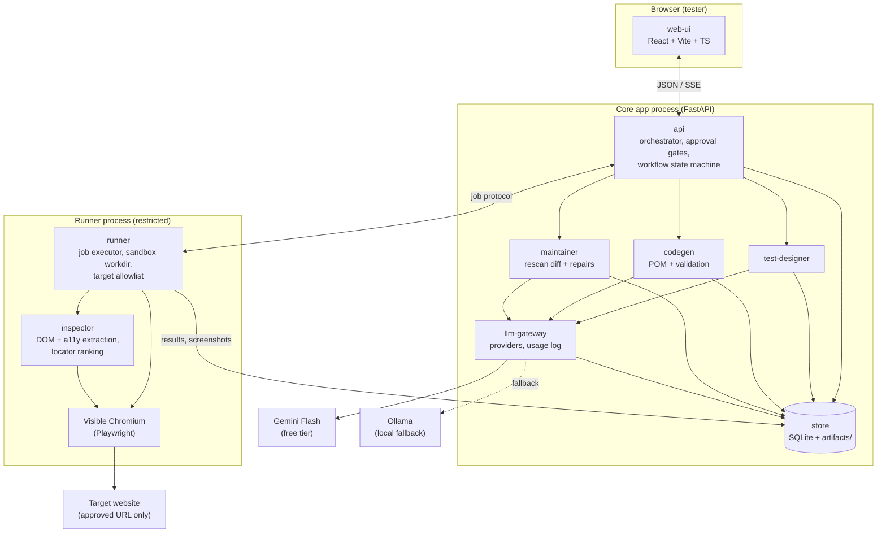
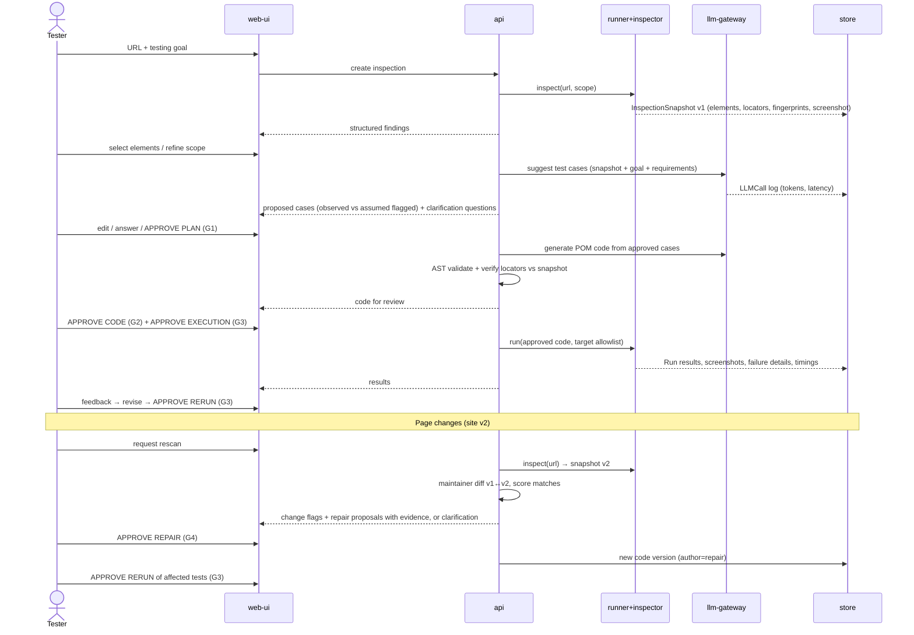
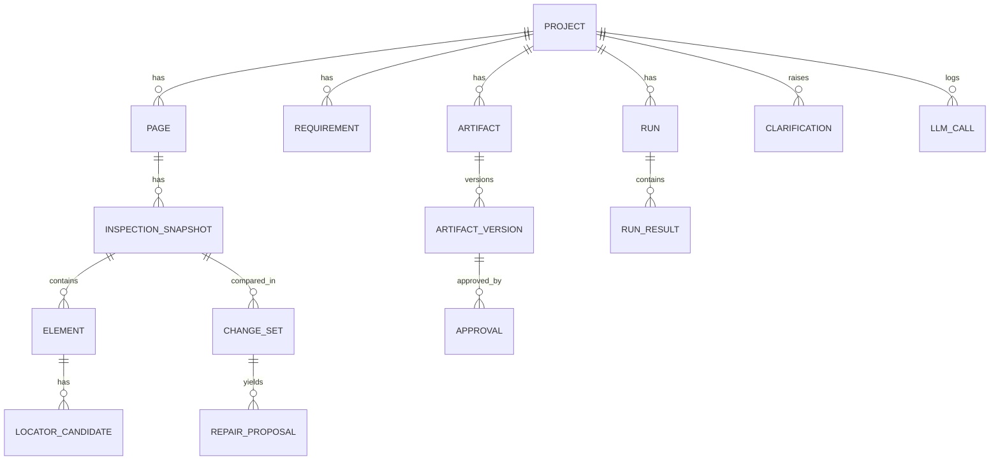

# High-Level Design — GATP

Status: **Draft v0.1** (2026-11-04, session S001). Satisfies REQ-P1-1 once diagrams are validated against the implementation.

## 1. Purpose and scope
GATP is a supervised assistant. It never acts on its own judgment where the brief requires a human: test plans, code execution, and maintenance repairs all pass through explicit approval gates. Everything it says about a page is traceable to a stored inspection snapshot.

## 2. Components

| Module | Responsibility | LLD |
|---|---|---|
| web-ui | Thin UI: URL entry, findings, element selection, goal/requirements, plan editor, code review, approvals, results, diffs, usage panel | [web-ui](../modules/web-ui/README.md) |
| api | HTTP/SSE API, workflow state machine, approval gates, clarification requests, job dispatch to runner | [api](../modules/api/README.md) |
| inspector | Extract interactive elements, labels, attributes, a11y role/name, candidate locators + live uniqueness, element fingerprints | [inspector](../modules/inspector/README.md) |
| store | SQLite schema, repositories, immutable versioning, artifact files | [store](../modules/store/README.md) |
| llm-gateway | Provider abstraction (Gemini, Ollama), structured output, prompt templates, token/latency logging, cache marking | [llm-gateway](../modules/llm-gateway/README.md) |
| test-designer | Propose grounded test cases; tag observations vs assumptions; raise clarifications | [test-designer](../modules/test-designer/README.md) |
| codegen | Generate pytest-playwright POM code; AST validation; locator verification against inspection | [codegen](../modules/codegen/README.md) |
| runner | Separate restricted process: runs inspections and approved tests in a visible browser, enforces target allowlist and sandbox | [runner](../modules/runner/README.md) |
| maintainer | Rescan, diff snapshots, score element matches, propose evidence-backed repairs or ask for clarification | [maintainer](../modules/maintainer/README.md) |

## 3. End-to-end data flow

## 4. Approval gates and clarification points

| Gate | Before | What the tester sees | Brief |
|---|---|---|---|
| G0 Scope | Inspection is used for design | Findings list; can include/exclude elements, refine scope, set goal | REQ-P1-3 |
| G1 Plan | Code generation | Test cases with actions, expected results, evidence links, and assumption flags | REQ-P2-1 |
| G2 Code | Execution can be requested | Generated POM + tests, validation report (syntax, locator checks) | REQ-P2-2 |
| G3 Execution | Any run or rerun | Exact tests, target URL, runner limits | REQ-G5 |
| G4 Repair | Applying a maintenance change | Old vs new locator, evidence, score, diff of code change | REQ-G5, REQ-Q4 |
| G5 Restore | Restoring an older version | Diff between current and target version | REQ-P2-5 |

**Clarification requests (CQ)** are first-class objects: they block the step that needs them, store the question, the evidence, and the tester's answer. Raised when expected behavior can't be established (REQ-Q2), when locators are not unique (REQ-Q1), and when repair candidates are ambiguous (REQ-Q4).

All approvals and clarifications are stored with timestamp, actor, and the version they apply to (audit trail, REQ-G2).

## 5. Validation layers
1. **Inspection:** locators ranked by Playwright priority (role+name → label → test-id → placeholder/text → CSS); each counted on the live page; usable only if count == 1 for single-element actions ([ADR-006](../decisions/ADR-006-locator-strategy.md)).
2. **LLM output:** structured JSON validated against schemas; any element reference must resolve to an element ID in the snapshot, otherwise rejected.
3. **Code:** Python `ast` parse; static check that every locator used by page objects exists in the snapshot and is unique; pytest collection dry-run in runner.
4. **Execution:** assertions are never rewritten to pass; failures stay visible (REQ-Q3).
5. **Maintenance:** deterministic match score with threshold + margin; below → clarification ([ADR-007](../decisions/ADR-007-maintenance-matching.md)).

## 6. How later phases use inspection results
- **Test design** gets only snapshot elements + user requirements; every step cites an element ID.
- **Codegen** builds page objects from snapshot locators (no invented selectors).
- **Execution** results map failures back to element IDs.
- **Maintenance** diffs the stored snapshot against a fresh one using element fingerprints.

## 7. Core data model (initial)

`ARTIFACT` kinds: `test_plan`, `test_case`, `page_object`, `test_file`. Versions are immutable ([ADR-005](../decisions/ADR-005-storage-and-versioning.md)).

## 8. Security and isolation
- Runner is a separate OS process with its own entrypoint; the core app never launches browsers itself (REQ-Q5).
- Runner accepts only typed jobs (`inspect`, `run_tests`), never shell commands (REQ-Q6).
- Each run gets a fresh sandbox working directory; only generated test files are written there; outputs copied back to `artifacts/`.
- Network: Playwright request routing aborts any request whose origin is not in the approved target allowlist (REQ-Q6).
- Page text is passed to the LLM only inside clearly delimited data fields with an instruction that it is untrusted data; LLM outputs are schema-validated, never executed directly (REQ-Q7).
- Secrets via `.env` only; `.env.example` committed.
- Details: [ADR-004](../decisions/ADR-004-runner-isolation.md), [runner LLD](../modules/runner/README.md).

## 9. Resource assumptions
| Resource | Assumption | Impact |
|---|---|---|
| Primary model | Gemini Flash free tier (exact model/version pinned in T-005; verify current limits) | Rate limits → caching + backoff; usage logged |
| Fallback model | Ollama, ~3B coder model on a 16 GB RAM machine (CPU likely); 7B optional and slow | Fallback for outages/limits; lower quality, documented |
| Demo machine | 16 GB RAM, GPU unconfirmed | Visible Chromium + Ollama must fit |
| Storage | SQLite single file + `artifacts/` | Reset by deleting `data/` |

## 10. Visibility
Every LLM call logs: provider, model, version, prompt template ID, input/output tokens (provider-reported or labelled `estimated`), latency, and `fresh|reused`. Test execution time is recorded separately per run and per test. The UI shows per-call metrics and session/page averages (REQ-P2-5, REQ-Q8–Q10).

## 11. Open design questions
Tracked in the [latest session log](../sessions/README.md) and resolved via ADRs.
